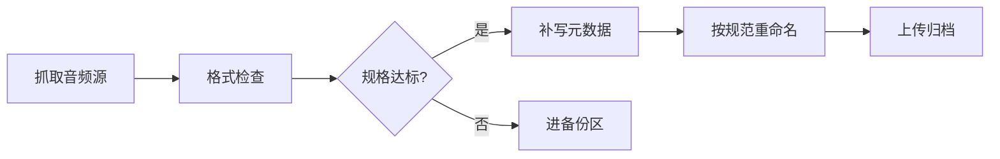

[TOC]

「逃少音乐档案馆」是长期维护的游戏 BGM 收录项目。这篇把收录流程固化下来。

## 收录标准

只有同时满足以下几条，才会被纳入正式归档：

1. **来源明确**：能追溯到游戏内具体场景 / 版本。
2. **完整无损**：优先 FLAC，其次 320kbps MP3，低于此规格只做备份不正式收录。
3. **命名规范**：`场景名 - 曲目名.ext`，如 `大厅 - Main Theme.flac`。

> [!NOTE]
> 同曲不同版本（如旧版 / 重编版）全部收录，文件名后缀加 `(v1)` `(v2)` 区分。

## 处理流程



## 目录结构

```
逃少音乐档案馆/
├─ BGM/
│  ├─ 大厅/
│  ├─ 战斗/
│  └─ 活动/
├─ 音效/
└─ 备份区/
```

## 当前进度

| 模块 | 已收录 | 待补 |
| --- | --- | --- |
| 大厅 BGM | 12 | 0 |
| 战斗 BGM | 8 | 3 |
| 活动限时 | 15 | 不明 |
| 角色语音 | 4 | 大量 |

## 需要帮助的地方

- 有旧版本客户端的同学，欢迎提供**早期版本**的战斗 BGM。
- 熟悉音频指纹比对的朋友，可以帮忙去重。

联系方式见 [关于页](/about.html)。
